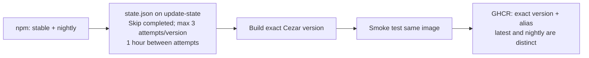
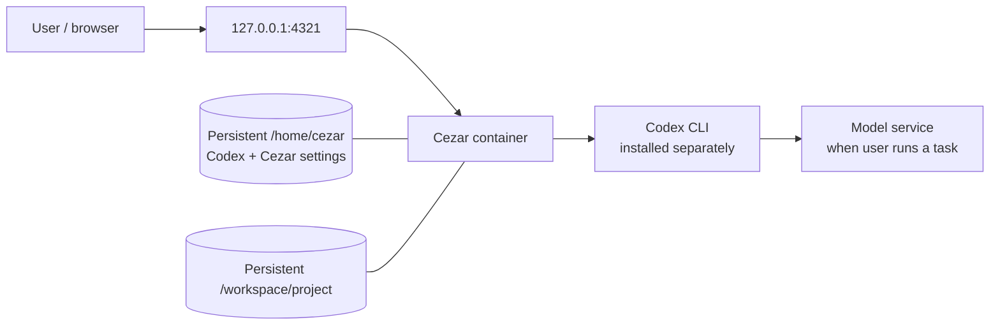

# Cezar Docker

Docker packaging for [upstream Cezar](https://github.com/open-mercato/cezar).
The image packages the unchanged Cezar npm release. Codex is installed separately
by the operator into a persistent home volume. Linux AMD64 only.

## Quick start

Docker Engine with Compose v2 or later is required. The default Compose image is
`ghcr.io/h3x89/cezar-docker:latest`. For a fixed release, choose an exact Cezar
version and pull it before starting Compose:

```sh
export CEZAR_IMAGE=ghcr.io/h3x89/cezar-docker:0.18.0
docker compose pull
docker compose up -d --no-build --wait
```

Images appear under the repository Packages after the first approved release.
A new GHCR package starts private: its owner must make it public once and verify
an anonymous pull. If the selected image has not been published yet, use the
local build instructions below.

Open <http://127.0.0.1:4321>. Cezar has no built-in authentication. Keep the
default loopback binding, or put an authenticating reverse proxy in front of it
for remote access. The default project volume is empty; add a project through
Cezar or mount a repository at `/workspace/project` with a Compose override.

## Install and sign in to Codex

Choose an exact stable Codex version. Run these commands as the default
container user, without sudo:

```sh
docker compose exec cezar codex-tool install 0.166.0
docker compose exec cezar codex login --device-auth
docker compose exec cezar codex login status
docker compose exec cezar codex-tool check
```

Follow the device-login link in your browser; your account may need device
authentication enabled. Select Codex as your runner in Cezar, then refresh the
cockpit's environment checks. Installation does not log in, change Cezar's
upstream runner defaults, or call a model.

To deliberately change the installed version, finish active tasks first:

```sh
docker compose exec cezar codex-tool update 0.166.0
```

`install` and `update` delegate the requested exact version to npm. There are
no fallback versions or retries. npm failures are returned to the caller; a
failed update can leave an incomplete installation that needs repair. `check`
verifies the launcher, package location, executable, and version, but not login.
Nothing installs or updates agents at container startup. Claude Code and other
agents are outside this MVP.

## Persistence and image updates

Compose keeps `/home/cezar` and `/workspace/project` in named volumes. The home
volume contains Codex's npm prefix (`.local/bin` and `.local/lib/node_modules`),
`.codex` login/configuration, and Cezar settings. Credentials are user data and
are never included in the image.

Keep the same Compose project name, volumes, UID/GID `1000:1000`, and `HOME` when
replacing containers. Stop active tasks before updating. Pull a newer image and
run `docker compose up -d --no-build --wait`; the Codex version in the home
volume remains under your control. Keep the base OS, Node and installed CLI
compatible when reusing a home volume. Login can expire or be revoked independently.

To roll back, set `CEZAR_IMAGE` to the previous image tag or digest, then repeat
the pull and `up` commands with the same volumes. This restores the image, not
changes already made to data in those volumes.

`docker compose down` stops the service and preserves named volumes.
`docker compose down --volumes` deletes their data.

## Build and smoke test locally

Build the exact version with the same image tag that the smoke script consumes:

```sh
export CEZAR_VERSION=0.18.0
export CODEX_VERSION=0.166.0
export CEZAR_IMAGE=cezar:local
docker build --platform linux/amd64 --build-arg "CEZAR_VERSION=$CEZAR_VERSION" -t "$CEZAR_IMAGE" .
bash scripts/smoke.sh
```

The smoke test uses an isolated, disposable Compose project. It installs real
Codex, checks the cockpit and a Cezar dry run, replaces the container with a
different image configuration, and checks persistence without reinstalling.
Its auth fixture is not a valid login. Separately verify that a real device login
survives replacement. The fixture does not make a model call.

Run the unit checks with:

```sh
python3 -m unittest discover -s tests -v
```

## Automated releases

The release workflow is intended for the default branch. It polls npm hourly
as a best-effort schedule; GitHub may delay or disable scheduled workflows
after 60 days without repository activity. An operator can also start it from
Actions with **Run workflow**. Inputs are an optional exact Cezar version
(empty polls stable and prerelease versions), channel (`version`, `latest`, or
`nightly`), `force` (explicitly rebuild the requested version), and Codex
version (default `0.166.0`).



The workflow builds, smoke tests the same image, then publishes the exact
version and, for those channels, its selected `latest` or `nightly` alias. The
two aliases remain separate. A completed version is skipped; each version gets at most three attempts with at
least one hour between attempts. A cancelled attempt counts. `force` explicitly
resets the requested version's state and rebuilds it; manual dispatch defaults
to channel `version`. The release workflow uses an ephemeral `GITHUB_TOKEN` for
GHCR and the state branch; registry login happens in the workflow. No personal
access token is needed.

The pull request workflow builds and tests without publishing. Merging the
release workflow to the default branch is the operator's point of approval for
enabling scheduled releases. Releases only update GHCR and workflow state; they
never deploy to a host. Codex updates remain manual. The Node base image digest
is pinned and must be updated manually for security maintenance; rebuilding a
Cezar version does not upgrade Node.

## Runtime model



## Release limits

The Cezar version and Node base digest are pinned. Transitive npm and system
packages resolve during the build, so builds are not guaranteed byte-for-byte
reproducible. Record the resulting image digest to identify an artifact.

## Operator acceptance

- Start the published image with the default loopback binding and persistent
  volumes.
- Install Codex, complete real device authentication, then verify `codex login status`
  and `codex-tool check`.
- Replace the container and confirm the login, settings, and project persist.
- Optionally run a real task to verify the complete setup; the smoke fixture
  alone does not verify a real task or model access.

## License

Container packaging, scripts, and documentation are available under the
[MIT License](LICENSE). Cezar and separately installed tools retain their own
licenses.
